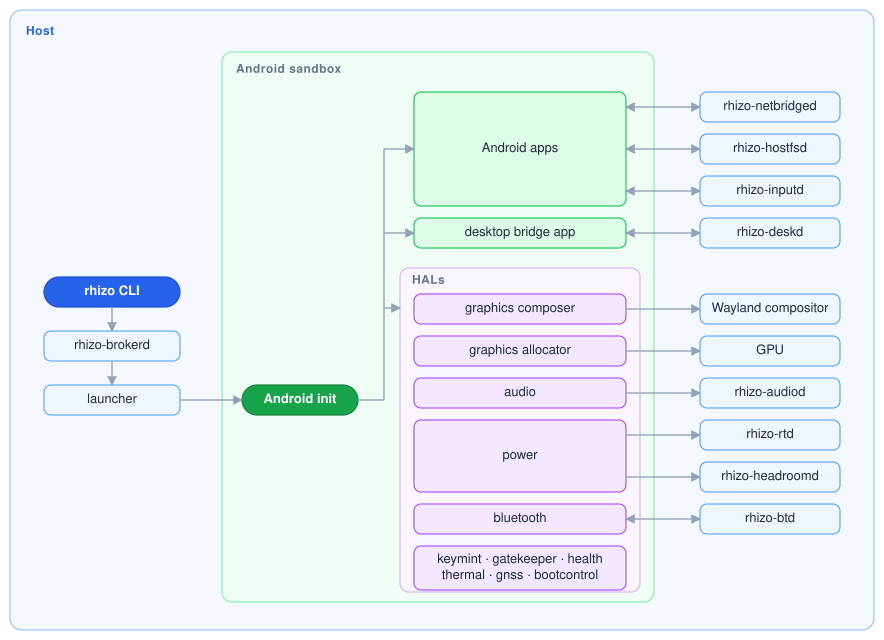

# Rhizo

Rhizo boots [stock Android GSI](https://source.android.com/docs/setup/build/gsi) on Linux using [SELinux namespaces](https://github.com/stephensmalley/selinux-kernel/tree/working-selinuxns), native HALs, and Linux namespaces.

Android runs unmodified with its full SELinux policy enforced at native speed.

### ...vs a container approach

Container-based approaches typically run a patched Android that has to be ported to each new release. The framework, init and hardware services are modified to fit the container, and SELinux is relaxed or disabled. Rhizo leaves the GSI image and platform SELinux policy unmodified, keeping changes within its HALs and kernel.

### ...vs a VM approach

VM-based approaches typically virtualize graphics, audio, input, network and storage, costing memory and speed, and struggle where nested virtualization is needed... additionally, they lack desktop integration. Rhizo needs no virtualization as its HALs run on the host hardware.

## Architecture



## Supported

- x86_64
- Android 16
- CachyOS + KDE Plasma
- Ubuntu 24.04 + GNOME

## Install

Download the packages from [Releases](https://github.com/liambilsbury/rhizo/releases), then:

CachyOS:

```bash
sudo pacman -U ./rhizo-[0-9]*.pkg.tar.zst ./linux-rhizo-*.pkg.tar.zst
```

Ubuntu 24.04:

```bash
sudo apt install ./rhizo_*.deb ./linux-image-rhizo_*.deb ./linux-headers-rhizo_*.deb
```

Then:

```bash
rhizo start
```

## Build

```bash
make setup
make inputs ACCEPT_ANDROID_SDK_LICENSE=1
make arch                       # -> var/arch-pkg/
make kernel-inputs kernel-arch  # -> var/kernel/cachyos/
make deb                        # -> var/debs/
make kernel-inputs kernel-deb   # -> var/kernel/ubuntu/
```

### GSI

The install downloads the prebuilt `gsi_x86_64` GSI from [Releases](https://github.com/liambilsbury/rhizo/releases). To build it from AOSP:

```bash
make gsi                        # -> var/gsi-build/
```

## License

[BSL 1.1](LICENSE)
